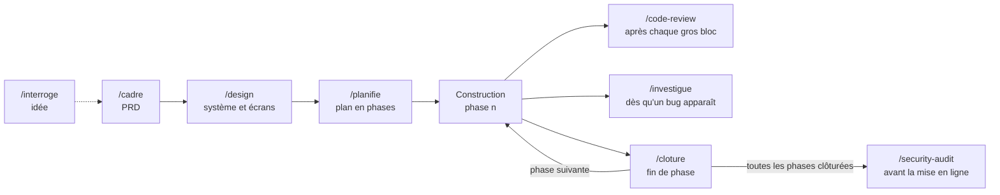

# Environnement agentique

La méthode et les outils avec lesquels je construis une application de bout en bout avec Claude Code.

### → [Ouvrir la carte interactive](https://maqssime7.github.io/environnement-agentique/)

Un plan de métro : chaque ligne est une partie du travail, chaque station un skill ou un outil. On zoome, on clique une station, sa fiche s'affiche.

## En une image

## La chaîne

| Étape | Skill | Ce qu'il produit |
|---|---|---|
| 1 | [`/cadre`](skills/cadre/SKILL.md) | Le PRD : problème, utilisateur, plateformes, critères de succès vérifiables, hors périmètre, évolutions qui contraignent la v1 dès maintenant. |
| 2 | [`/design`](skills/design/SKILL.md) | Le système de design adapté à la plateforme, une palette aux contrastes corrigés par script, et des écrans composés à partir de composants existants. |
| 3 | [`/planifie`](skills/planifie/SKILL.md) | L'architecture tranchée par l'IA, puis des phases en tranches verticales, avec critères d'acceptation, contenu de test et parcours de régression. |
| 4 | Construction | Une phase à la fois. Chaque écran est ouvert et regardé dès qu'il existe. |

En amont, facultatif : [`/interroge`](skills/interroge/SKILL.md) pour faire mûrir une idée floue.

## Pendant la construction

| Quand | Skill | Ce qu'il garantit |
|---|---|---|
| Après chaque gros bloc de code | `/code-review` (intégré à Claude Code) | Une relecture des défauts de comportement et de sécurité avant d'annoncer que c'est fini. |
| Dès qu'un bug apparaît | [`/investigue`](skills/investigue/SKILL.md) | Bug reproduit, cause prouvée, correctif minimal, symptôme rejoué. Autonome, sauf avant un correctif irréversible. |
| À la fin de chaque phase | [`/cloture`](skills/cloture/SKILL.md) | Chaque critère repris avec sa preuve, test du cloisonnement entre deux comptes, régression de toutes les phases précédentes. |

## Avant la mise en ligne

| Quand | Skill | Ce qu'il garantit |
|---|---|---|
| Une fois toutes les phases clôturées, avant d'ouvrir l'app au public | [`/security-audit`](https://github.com/cloudflare/security-audit-skill) (Cloudflare) | Un audit de sécurité de l'application entière. De nombreux agents se répartissent le code et cherchent comment franchir une frontière (compte A vers compte B, visiteur vers administrateur). Chaque faille trouvée est revérifiée par un agent neuf, et seules les failles prouvées reçoivent une gravité. |

- **Différence avec `/code-review` et `/cloture`** : eux relisent un changement ou une phase ; `/security-audit` relit toute l'application, du point de vue d'un attaquant.
- **Coût** : c'est l'étape la plus chère de la méthode. Il ne se lance donc jamais de lui-même, seulement sur demande explicite.
- **Limite** : il lit le code et ne touche jamais au site en ligne. Ce qui dépend de l'hébergement (réglages, en-têtes, règles d'accès configurées hors du dépôt) est rangé dans « à vérifier », jamais déclaré sûr.
- **Produit** : un rapport, le détail de chaque faille avec sa preuve et le plus petit correctif, et la liste de ce qui reste à vérifier.

## Faire évoluer l'environnement

- [`/cherche-skill`](skills/cherche-skill/SKILL.md) : trouve un skill existant pour un domaine nouveau, et lit tous ses fichiers avant de proposer de l'installer. Un skill trouvé s'installe dans le projet en cours, jamais pour tous les projets.
- [`/passation`](skills/passation/SKILL.md) : passe la main entre Claude Code et Codex, le dépôt comme seul canal.

## Les outils de l'IA

| Rubrique | Outil | Usage |
|---|---|---|
| Navigation | Playwright | Regarder l'app construite : mobile et bureau, mode sombre, états, console. |
| | Claude in Chrome | Les vrais sites et les services où l'on est connecté. |
| | Computer use | Les applications du Mac, en dernier recours. |
| Design | tweakcn | Choisir une palette en la voyant en direct sur de vrais composants. |
| | shadcn | Assembler des composants et des blocs existants plutôt que les dessiner. |
| | Canevas Design de Claude | Poser les premiers écrans côte à côte et les commenter. |
| Documentation | Context7 | La documentation à jour des bibliothèques qui changent vite. |

## Principes

1. **L'humain tranche le produit, l'IA le technique.** Les points d'arrêt sont placés là où une décision coûte cher à défaire, nulle part ailleurs.
2. **Rien n'est fini sans preuve.** Chaque compte rendu sépare le vérifié, le non vérifié et le cassé.
3. **Des exigences, pas des recettes.** Un skill dit ce qui doit être vrai à la fin, pour ne pas brider des modèles qui progressent.
4. **La sécurité signalée d'office.** Secrets, cloisonnement des données, bugs silencieux.
5. **Le dépôt comme seule mémoire.** Chaque décision finit dans un document versionné.

## Contenu du dépôt

- `skills/` : les skills que j'ai écrits, tels que je les utilise. Ils sont là pour être lus. `/security-audit` n'y est pas recopié : il s'installe depuis le dépôt de Cloudflare.
- `skills/design/scripts/contraste.mjs` : mesure et corrige les contrastes d'un thème (`node contraste.mjs <thème> --corriger sortie.css`).
- `docs/index.html` : la carte interactive, un seul fichier, sans dépendance.

## Inspirations

`/interroge` est une adaptation française de [`grill-me`](https://github.com/mattpocock/skills), et `/cadre` et `/planifie` sont partis des skills de PRD et de découpage en tranches verticales du même dépôt de Matt Pocock, avant d'être réécrits pour cette méthode.

`/security-audit` est le skill d'audit publié par [Cloudflare](https://github.com/cloudflare/security-audit-skill) (licence MIT), utilisé tel quel ; seule sa description est traduite en français.
